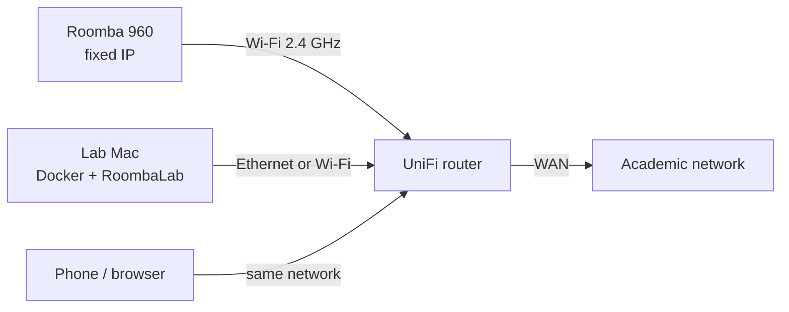

# Installation guide — from a blank Mac to a running lab

This guide installs RoombaLab on a Mac (Intel or Apple silicon) that stays on permanently next to the
robot. Every step says what it does and how to check it worked. Allow about an hour, most of it for the
network and robot pairing.



The robot and the Mac must be on the **same UniFi network**: the robot accepts local connections only,
and the academic network gives out addresses you do not control.

---

## 1. Check the Mac

1. Apple menu → **About This Mac**: note the chip (Intel or Apple) and the macOS version.
2. Docker Desktop supports the **current and the two previous major macOS releases**, and needs at
   least 4 GB of RAM. If the Mac's macOS is older than that, update macOS first.
3. You need an administrator account on the Mac (for `sudo` below).

## 2. Install Docker Desktop

1. Download it from <https://docs.docker.com/desktop/setup/install/mac-install/>. Pick
   **"Docker Desktop for Mac with Intel chip"** or **"… with Apple silicon"** to match step 1.
2. Open `Docker.dmg` and drag **Docker** into **Applications**.
3. Start **Docker** from Applications and accept the subscription agreement. Use is free for
   education, individuals and small organisations (see Docker's terms for the exact conditions).
4. In Docker Desktop → **Settings → General**, tick **"Start Docker Desktop when you sign in to your
   computer"**. Without it, the lab stops after every reboot.

Check, in Terminal:
```bash
docker --version
```
```bash
docker compose version
```
Both should print a version, not an error.

## 3. Install git and download RoombaLab

1. Install Apple's command-line tools, which include git (skip if `git --version` already works):
   ```bash
   xcode-select --install
   ```
2. Choose where the lab lives, then download it (the repository is public, no login needed):
   ```bash
   mkdir -p ~/Lab && cd ~/Lab
   ```
   ```bash
   git clone https://github.com/Ben0x0a/RoombaLab.git
   ```
   ```bash
   cd RoombaLab
   ```

Check: `ls` shows `docker-compose.yml`, `src`, `public`, `docs`.

## 4. Network: robot and Mac on UniFi

In the UniFi Network application (menu names vary between versions):

1. **Create a Wi-Fi network for the robot**, e.g. `roomba-iot`:
   - band **2.4 GHz only** (the 960 has no 5 GHz radio);
   - security **WPA2 Personal** (not WPA2/WPA3);
   - **PMF off**, **fast roaming off**, **band steering off**;
   - **client device isolation off**, otherwise the Mac cannot reach the robot;
   - attached to the same LAN/VLAN as the Mac.
2. **Connect the Mac to the UniFi network** (Ethernet preferred, or Wi-Fi), and give it a **Fixed IP**
   in UniFi → Client Devices → the Mac → Settings.

## 5. Pair the robot with the Wi-Fi network

1. Put the robot **on its dock and let it charge**.
2. If it was paired before, enter setup mode: hold **DOCK + SPOT** for about 5 seconds.
   If setup still fails, remove the battery for a full minute, put it back, and try again.
3. Put your phone on the `roomba-iot` network, then add the robot in the **iRobot Home** app and
   follow its steps, staying next to the robot. Turning off mobile data and any VPN on the phone during
   pairing can help.
   - Error **WR030C** means the app could not reach the robot: check it is docked and charging.
4. In UniFi → Client Devices, find the robot (hostname starting with `roomba-` or `iRobot-`) and give it
   a **Fixed IP**, e.g. `192.168.1.96`.

Check, from the Mac (replace the address):
```bash
nc -z -G 5 192.168.1.96 8883 && echo "robot reachable"
```

## 6. Get the robot's BLID and password

The robot's local MQTT login is a BLID and a password. They are **secrets**: never commit them or put
them in a report.

**Cloud method** (uses your iRobot account once; RoombaLab itself stays local). The password is not
shown on screen nor kept in the shell history:
```bash
read "IR_USER?iRobot email: " && read -s "IR_PASS?iRobot password: " && echo && docker run --rm -it -e IR_USER="$IR_USER" -e IR_PASS="$IR_PASS" node:20-bookworm sh -c 'npm install -g dorita980 >/dev/null 2>&1 && get-roomba-password-cloud "$IR_USER" "$IR_PASS"'; unset IR_USER IR_PASS
```
It prints each robot on the account with its BLID and password.

**Local method** (robot docked, iRobot app closed on every phone; follow the prompt to press HOME):
```bash
docker run --rm -it python:3.12-slim sh -c 'pip install -q "roombapy[cli]==2.0.2" && roombapy discover 192.168.1.96'
```

If you re-pair the robot later, fetch the credentials again: the old ones may be rejected.

## 7. Configure RoombaLab

```bash
cp .env.example .env
```
```bash
open -e .env
```
Set at least:

| Setting | Value |
|---|---|
| `ROOMBA_IP` | the robot's fixed IP from step 5 |
| `ROOMBA_BLID`, `ROOMBA_PASSWORD` | from step 6 |
| `HOST_PORT` | `8080`, or another port if 8080 is already used on this Mac |

The other settings are explained in the file itself.

## 8. Start it

```bash
docker compose up -d --build
```
The first build downloads Python and the dependencies (a few minutes). Then:
```bash
docker compose logs -f
```
Wait for `Connected to Roomba 192.168.1.96`, then press `Ctrl+C` (the lab keeps running).

Check:
- open <http://localhost:8080>: the header shows a green **connected** dot;
- **Raw data** tab → **Verify integrity**: "Chain intact".

## 9. Keep it running 24/7

Docker restarts the container by itself (`restart: unless-stopped`), and the collector reconnects to
the robot on its own. The Mac must stay awake and logged in:

1. Never sleep, restart after a power cut:
   ```bash
   sudo pmset -a sleep 0 disksleep 0 autorestart 1
   ```
   Check with `pmset -g`: `sleep 0` and `autorestart 1` are listed.
2. **Log in automatically** after a restart: System Settings → **Users & Groups** → "Automatically
   log in as". macOS disables this option while FileVault is on; decide with your IT policy.
3. Docker Desktop starts at login (step 2.4).

Test once: restart the Mac, wait two minutes, open <http://localhost:8080>.

## 10. Use it from a phone

On a phone connected to the UniFi Wi-Fi, open `http://<Mac fixed IP>:8080`. The **Robot** tab opens on
the control panel.

The interface has **no login**: anyone on the UniFi network can send commands. To reach it from the
academic network, add one UniFi **port forward** to the Mac's port 8080 only, limited to your own
addresses if UniFi allows it, and check with IT that inbound connections are allowed. Never forward
port 8883 to the robot.

## 11. Read the data

The live database is in a Docker volume that only the container opens. Opening it from macOS while the
container writes can corrupt it.

- Readable copy: `data/snapshots/roombalab-latest.sqlite` (with its `.sha256`), refreshed at start-up,
  every `SNAPSHOT_HOURS` and with the **Copy database** button. Open it with any SQLite tool.
- Export of the raw log: **Raw data → Export JSONL**.
- Direct query on the live database, through the container:
  ```bash
  docker compose exec roombalab /app/.venv/bin/python -m sqlite3 /db/roombalab.sqlite
  ```

For a backup, copy `data/snapshots/` elsewhere.

### Disk space

Every `RETENTION_CHECK_HOURS` (and at start-up) RoombaLab checks Docker's disk and the Mac's disk. If
either is at or above `DISK_THRESHOLD_PCT`, raw data older than `RETENTION_MIN_DAYS` is archived to
`data/archive/` (compressed JSONL with a `.sha256`) and then deleted, oldest Wi-Fi signal messages first.
Recent data is never deleted, so a disk filled by other files can stay above the threshold: the
**Raw data** tab shows the usage of both disks and the last clean-up. Growth is about 20 MB a day.

## 12. Update

```bash
cd ~/Lab/RoombaLab
```
```bash
git pull
```
```bash
docker compose up -d --build
```
The database volume is kept.

## 13. Troubleshooting

| Symptom | Cause and fix |
|---|---|
| `no configuration file provided` | The command was run outside the RoombaLab folder: `cd ~/Lab/RoombaLab` first. |
| `.env` edited but nothing changes | `docker compose restart` does not re-read `.env`. Use `docker compose up -d`. |
| Log: `rejected the credentials` | Wrong or outdated BLID/password: redo step 6, edit `.env`, then `docker compose up -d`. |
| Log: `Roomba unreachable … timed out` | Mac or robot not on the UniFi network, wrong IP, or client isolation on (step 4). Test with `nc` (step 5). |
| Connected, then drops when the phone app opens | The robot accepts one local client at a time; close the iRobot app. |
| `port is already allocated` | Another program uses the port: change `HOST_PORT` in `.env`, then `docker compose up -d`. |
| Docker commands fail with `Cannot connect to the Docker daemon` | Docker Desktop is not running: start it (step 2). |

Logs: `docker compose logs --tail 100`.

## 14. Remove

```bash
docker compose down
```
stops the lab and keeps the data. To also **delete the database** (irreversible):
```bash
docker volume rm roombalab_db
```
